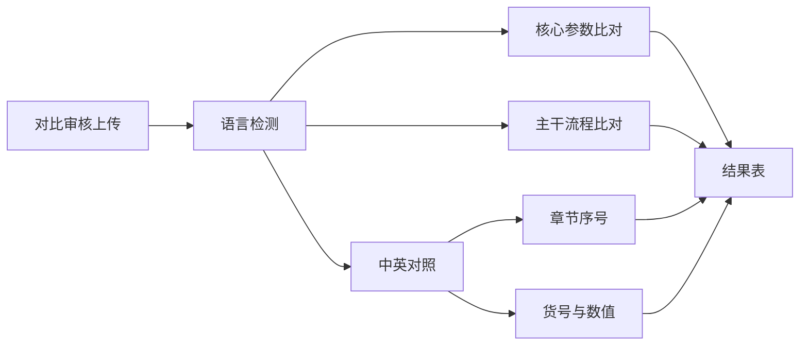

# 对比审核中英对照

Feature Name: compare-audit-bilingual-align
Updated: 2026-11-26

## Description

对比审核自动检测主文档与参考文件语言。仅当同时存在中文和英文时，在原有核心参数、主干流程比对之外追加确定性中英对照行。

## Architecture

## Components and Interfaces

- `POST /api/review/compare-audit/run`: 既有入口，summary.bilingual 标识对照模式
- `app.review_engine.bilingual_align`: 语言检测、章节对齐、事实 token、可选 AI 语义
- `_build_compare_audit_payload`: 双语时放宽参数值匹配并合并对照行
- `Review.vue`: 中英对照徽章与明细表

## Data Models

- compare_rows.kind: `parameter` / `flow` / `bilingual`
- summary.bilingual: 是否进入中英对照
- summary.main_language / language_label: 主文档语言

## Correctness Properties

- 同语言对比不产生 bilingual 行
- `2–8℃` 与 `2–8°C` 在双语模式下判为一致
- 货号/型号不一致为 P0；纯译名差异为 P2
- AI 语义默认关闭，单测不依赖外部模型

## Error Handling

- 无法识别对侧语言时回退到原有对比审核
- AI 语义失败时跳过语义行，保留确定性结果

## Test Strategy

- `backend/tests/test_compare_bilingual_align.py` 覆盖语言检测、数值对齐、缺章、货号 P0 和 payload 开关
