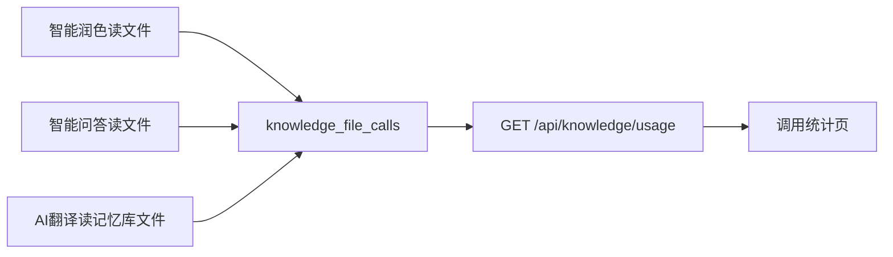
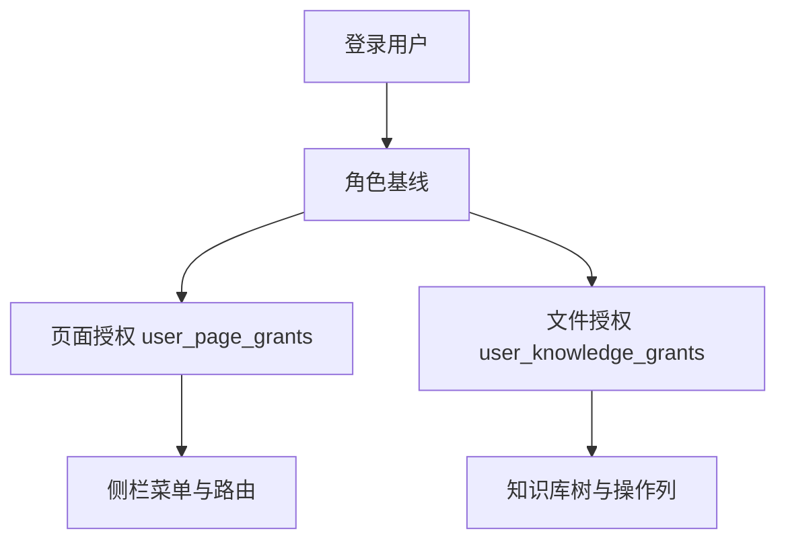

# Technical Design: 知识库调用统计与授权覆盖

## Overview

本轮实现知识库文件调用统计。智能润色、智能问答、AI 翻译在读取知识库文件时写入 knowledge_file_calls，管理员在知识库管理的调用统计页查看汇总与明细。

页面授权与文件授权留到下轮。角色基线保持管理员与普通用户两档，授权只做覆盖，不新增角色。

## Architecture

请求进入上述三个模块时，FastAPI 依赖把当前账号写入 contextvar。文件读取点计时后另开会话写入调用记录。写入失败只打日志，原业务继续。

## Data Model

表 knowledge_file_calls：

- id 主键
- file_id 知识库文件 ID，不加外键，文件删除后统计仍可按 ID 展示
- module 取值 polish / qa / translation
- user_id 可空
- username 无登录账号时为 guest
- duration_ms 单次读取耗时
- created_at UTC naive，接口输出转北京时间

## Call Recording

| 模块 | 埋点 |
| --- | --- |
| 智能润色 | polish_lab._load_file_content、_load_terminology_source、句式清单与术语按文件读取 |
| 智能问答 | qa._load_qa_documents 每个成功抽取内容的文件 |
| AI 翻译 | translation._get_cached_memory_file_entries 使用记忆库知识库文件 |

只记录知识库 KnowledgeFile。润色 bundled 静态句式文件没有文件 ID，不入库。

进程内句式缓存命中时不重复写盘读取，该次不新增调用记录。

## Stats API

- GET /api/knowledge/usage/summary?module=&start=&end=&q=
- GET /api/knowledge/usage/files/{file_id}?module=&start=&end=&offset=&limit=

均需管理员。start/end 为北京日期 YYYY-MM-DD。

汇总字段：文件名、文件夹路径、调用次数、调用模块、累计耗时、调用账号数、最近调用时间。

明细字段：调用时间、模块中文名、账号、耗时毫秒。

## Frontend

侧栏知识库管理改为子菜单：知识库、调用统计。调用统计仅管理员可见，路由 /knowledge/stats 设 adminOnly，写在 /knowledge/:id 之前。

页面提供日期范围、模块筛选、文件名搜索、汇总卡片、文件表、行点击抽屉看明细。

## Next Round: Access Grants

角色基线先判定，授权再覆盖。管理员仍拥有全部能力。

### 页面授权

表 user_page_grants：user_id、page_key、granted_by、created_at。同一用户同一页面键唯一。

页面键与当前隐藏入口对齐：

- polish.rules 润色规则
- polish.candidates AI 诊断候补
- polish.stats.sessions 润色文本/文档会话详情
- review.rules 审核规则
- review.false_positive_memory 误报记忆库
- qa.history 问答历史
- qa.dashboard 问答看板
- knowledge.stats 知识库调用统计

判定：管理员，或页面属于角色基线，或用户持有该页面授权。

前端登录后下发 page_grants，菜单与路由守卫共用 canAccess(pageKey)。后端把上述接口的 require_admin 换成 require_page(page_key)。

管理入口放用户管理：给某个普通用户勾选额外页面。撤销后立即回到角色基线。

### 文件授权

表 user_knowledge_grants：user_id、target_type 为 file 或 folder、target_id、action 为 preview / download / edit、granted_by、created_at。

文件夹授权沿子树继承。动作可叠加：edit 含预览与下载，download 含预览。

树展示：角色基线内的写作规范与资源库保持可见；额外授权的文件把它到根的祖先节点一并展开，祖先只读。操作列按该用户有效动作显示预览、下载、编辑。

管理入口放知识库文件或文件夹的「授权给用户」，下轮再做。本轮不建这两张表。

## Testing

- 写入调用记录、guest 账号、管理员汇总/明细、普通用户 403
- 润色/问答/翻译读取点会落到记录表
