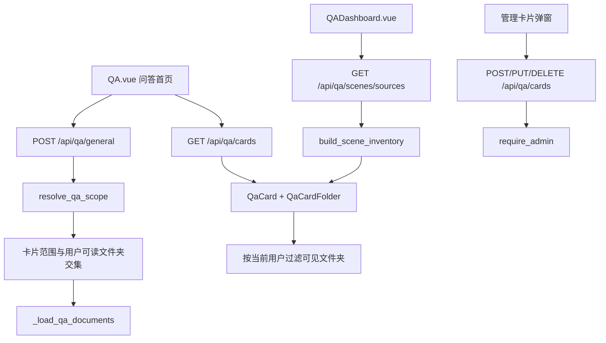

# QA Custom Cards

Feature Name: qa-custom-cards
Updated: 2026-11-26

## Description

把知识库问答首页的四张静态卡片改为数据库配置。管理员可在首页管理卡片，配置标题、说明、分类标签、主题色、推荐问题、知识库文件夹范围、首页显示状态和顺序。普通用户使用同一批卡片，但检索范围和资料数量只计算其可读文件夹。统计面板的资料清单改为读取同一批卡片数据，不再依赖前后端两份静态路径映射。

## Decisions

- 管理能力：新建、编辑、删除、排序、隐藏
- 普通用户：卡片全部可见，检索范围收窄为卡片范围与用户可读文件夹的交集
- 卡片字段：标题、说明、分类标签、主题色、推荐问题、文件夹集合、首页显示状态、排序

## Architecture

数据库是卡片配置的唯一来源。前端不再维护 `SCENE_CARDS`，后端不再用 `QA_SCENES.paths` 生成首页卡片；`QA_SCENES` 只保留为首次初始化数据。

## Data Model

### qa_cards

| 字段 | 类型 | 说明 |
| --- | --- | --- |
| id | Integer PK | 主键 |
| key | String unique | 稳定标识，新建时生成 `card-<12位十六进制>` |
| kicker | String | 分类标签 |
| title | String | 卡片标题 |
| description | String | 卡片说明 |
| accent | String | 主题色，`#RRGGBB` |
| suggestions_json | Text | 推荐问题 JSON 数组 |
| home_visible | Boolean | 是否在首页显示，默认 true |
| sort_order | Integer | 升序排列 |
| created_by | Integer | 创建人 |
| created_at | DateTime | 创建时间 |
| updated_at | DateTime | 更新时间 |

### qa_card_folders

| 字段 | 类型 | 说明 |
| --- | --- | --- |
| id | Integer PK | 主键 |
| card_id | FK qa_cards.id | 删除卡片时级联删除 |
| folder_id | FK folders.id | 删除文件夹时级联删除 |

`(card_id, folder_id)` 唯一。卡片只保存管理员勾选的文件夹，子孙目录在查询和统计时动态展开，后续新增子目录会自动纳入范围。

### qa_card_seed_state

单行表，记录内置卡片是否已完成首次初始化。存在该记录后不再自动写入内置卡片，管理员删除全部内置卡片也不会在重启后恢复。

## Default Card Seeding

`backend/app/utils/qa_scenes.py` 的 `QA_SCENES` 扩展为完整的内置卡片定义，包含 `key`、`kicker`、`title`、`description`、`accent`、`suggestions`、`home_visible`、`paths`。

`seed_default_qa_cards(db)` 在 `seed_knowledge_base()` 之后执行：

1. 若 `qa_card_seed_state` 已有记录，直接返回
2. 若 `qa_cards` 已有数据但无 seed 记录，只写 seed 记录，避免重复插入
3. 否则按 `QA_SCENES` 创建四张卡片，路径解析成功的文件夹写入 `qa_card_folders`
4. 路径解析失败的卡片仍创建，首页显示目录待同步
5. 写入 seed 记录并提交

内置卡片的 `key` 保持 `style`、`phrase`、`term`、`files`。管理员可编辑、排序、隐藏或删除。

## API

### GET /api/qa/cards

登录用户可用。返回按 `sort_order`、`id` 升序的卡片列表。

- 普通用户只返回 `home_visible=true` 的卡片
- 管理员默认也只返回 `home_visible=true`
- 管理员传 `include_hidden=true` 时返回全部卡片，供管理弹窗使用
- `folder_ids` 只返回当前用户可见的文件夹 ID，避免暴露不可见范围
- 响应字段：`id`、`key`、`kicker`、`title`、`description`、`accent`、`suggestions`、`home_visible`、`sort_order`、`folder_ids`

### POST /api/qa/cards

仅管理员。请求字段：`kicker`、`title`、`description`、`accent`、`suggestions`、`folder_ids`、`home_visible`、`sort_order`。

校验：

- `title` 去空格后 1 到 30 字符
- `kicker` 最多 12 字符，空值存为「自定义」
- `description` 最多 120 字符
- `accent` 匹配 `^#[0-9a-fA-F]{6}$`
- `suggestions` 最多 6 条，每条最多 120 字符，自动去空
- `folder_ids` 至少 1 个，全部存在，且不属于「AI agent知识库」
- 未传 `sort_order` 时取当前最大值加 10

### PUT /api/qa/cards/{card_id}

仅管理员。字段与创建一致，`key` 不变。文件夹集合整体替换。

### DELETE /api/qa/cards/{card_id}

仅管理员。删除卡片及文件夹关联，首页和统计面板同时移除。

### PUT /api/qa/cards/order

仅管理员。请求 `{ "card_ids": [3, 1, 2] }`，校验集合与现有卡片一致，按 10、20、30 重写 `sort_order`。

### GET /api/qa/scenes/sources

保持仅管理员。改为使用 `build_scene_inventory(db)` 读取数据库卡片，返回全部卡片（含隐藏卡片）的目录数、资料数和文件清单。

## Permission-Safe Scope

新增 `resolve_qa_scope(db, user, requested_ids)`，放在 `backend/app/utils/knowledge_access.py`。

1. 加载全部文件夹和 `visible_folder_actions`
2. 允许集合只包含带 `read` 动作的文件夹，并排除「AI agent知识库」及其子孙
3. 有 `requested_ids` 时，对每个 ID 递归展开子孙，与允许集合求交
4. 无 `requested_ids` 时，返回全部允许集合

`_load_qa_documents` 改为接收已经展开的文件夹 ID 列表，只读取这些目录的直接文件，不再自行递归。这样父目录结构可见但未授权的兄弟目录不会被带入检索。

`POST /api/qa/general` 与 `GET /api/qa/suggestions/initial` 都改用 `get_current_active_user`，先调用 `resolve_qa_scope` 再加载文档。管理员得到全部非 agent 文件夹，普通用户只得到可读文件夹。

## Inventory

`build_scene_inventory(db)` 改为遍历数据库卡片：

1. 读取卡片关联的文件夹 ID
2. 递归展开子孙目录并去重
3. 跳过「AI agent知识库」及其子孙
4. 按文件 ID 去重收集文件
5. 返回 `id`、`key`、`kicker`、`title`、`description`、`accent`、`home_visible`、`sort_order`、`folder_count`、`file_count`、`files`

统计面板和首页使用同一批卡片，隐藏卡片只在统计面板出现。`missing_paths` 字段移除，空态文案由 `folder_count` 判断。

## Frontend

### QA.vue

- 删除静态 `SCENE_CARDS`，挂载时并行加载知识树和 `qaAPI.getCards()`
- `sceneCards` 保存接口卡片；首页直接渲染接口结果
- 知识树节点保留 `actions`、`readable`、`directCount`，并建立 `folderNodeMap`
- `cardEffectiveFolderIds(card)` 取卡片 `folder_ids` 与知识树交集，递归收集可读子孙
- `cardDocCount(card)` 对有效文件夹 ID 去重后累加直接文件数
- `sceneDocLabel(card)` 在加载中显示读取提示；无有效范围显示「暂无可检索资料」；范围为 0 显示「目录待同步」；否则显示资料份数
- `enterScene(card)` 在有效范围为空时提示「该卡片在当前权限范围内暂无可用资料」
- 管理员在首页看到「管理卡片」入口；普通用户不显示
- 卡片网格改为自适应列数，支持任意数量卡片
- 无可见卡片时展示空态

### QaCardManager.vue

新增 `frontend/src/components/QaCardManager.vue`，用抽屉承载管理功能：

- 列表展示全部卡片，含隐藏标记
- 上移、下移调整顺序，保存时调用排序接口
- 显示开关直接保存
- 新建、编辑、删除
- 编辑表单包含标题、说明、分类标签、主题色、推荐问题、文件夹、首页显示
- 推荐问题用多行文本，一行一条，最多 6 条
- 文件夹用 `el-tree` 多选，默认父子联动；提交前把已选节点裁剪为最高层节点
- 文件夹树不展示「AI agent知识库」

### QADashboard.vue

- 资料清单继续按卡片分段
- 标题使用接口返回的 `kicker`、`title`
- 显示 `folder_count` 和 `file_count`
- 空态只显示「该板块暂无资料」
- 隐藏卡片仍显示在该面板

### API Client

`frontend/src/api/index.js` 的 `qaAPI` 新增：

- `getCards(params)`
- `createCard(payload)`
- `updateCard(id, payload)`
- `deleteCard(id)`
- `reorderCards(cardIds)`

## Migration and Startup

- `create_tables()` 导入 `app.models.qa_card`，由 `Base.metadata.create_all` 创建三张新表
- 不需要修改现有表结构
- `main.py` 在知识库种子同步成功后调用 `seed_default_qa_cards`
- 文件夹删除时显式清理 `qa_card_folders` 中对应文件夹及其子孙的关联，避免依赖 SQLite 外键行为

## Correctness Properties

- 任何卡片范围都不包含「AI agent知识库」及其子孙
- 普通用户通过任何卡片发起的检索，文件夹集合都是其可读文件夹的子集
- 同一卡片中重复勾选或父子重叠的文件夹只计算一次
- 首页可见卡片集合等于 `home_visible=true` 的卡片
- 统计面板卡片集合等于全部卡片，包括隐藏卡片
- 新建或编辑卡片后，首页和统计面板在下一次加载时读取同一份数据库配置
- 内置卡片只初始化一次，管理员删除后不会自动恢复
- 管理员之外的任何用户调用卡片写接口返回 403

## Error Handling

- 表单校验失败返回 400，详情说明具体字段
- 卡片不存在返回 404
- 普通用户调用管理接口返回 403
- 文件夹在保存前被删除返回 400
- 卡片范围为空时问答返回现有「当前知识范围内没有可用文档」，前端同时提示暂无可用资料
- 知识树加载失败沿用现有提示，卡片仍然渲染，资料数显示为待同步
- 统计面板静默刷新失败保留上一次成功数据

## Test Strategy

- 新增 `backend/tests/test_qa_cards.py`
  - 内置卡片首次初始化、幂等、删除后不恢复
  - 管理员创建、编辑、删除、排序、隐藏
  - 标题为空、文件夹为空、agent 文件夹、非法颜色被拒绝
  - 普通用户读取卡片只得到可见文件夹，写接口 403
  - `build_scene_inventory` 使用数据库卡片并反映新增、编辑、删除
- 改造 `backend/tests/test_qa_scenes.py`
  - 用数据库卡片构造统计场景
  - 保留子孙目录、agent 跳过、文件去重、实时变化用例
- 新增权限范围测试
  - 普通用户父目录可见但兄弟目录未授权时，`resolve_qa_scope` 不包含未授权目录
  - 卡片父目录范围只返回用户可读子孙
- 前端用 Vite dev server 编译 `QA.vue`、`QaCardManager.vue`、`QADashboard.vue`
- 手工验收：管理员新建卡片并勾选文件夹，首页立即出现；普通用户只能检索授权范围；统计面板显示同一卡片

## References

- `frontend/src/views/QA.vue`
- `frontend/src/views/QADashboard.vue`
- `frontend/src/components/QaCardManager.vue`
- `frontend/src/api/index.js`
- `backend/app/models/qa_card.py`
- `backend/app/models/knowledge.py`
- `backend/app/api/qa.py`
- `backend/app/api/knowledge.py`
- `backend/app/crud/knowledge.py`
- `backend/app/utils/qa_scenes.py`
- `backend/app/utils/knowledge_access.py`
- `backend/app/utils/qa_knowledge_scope.py`
