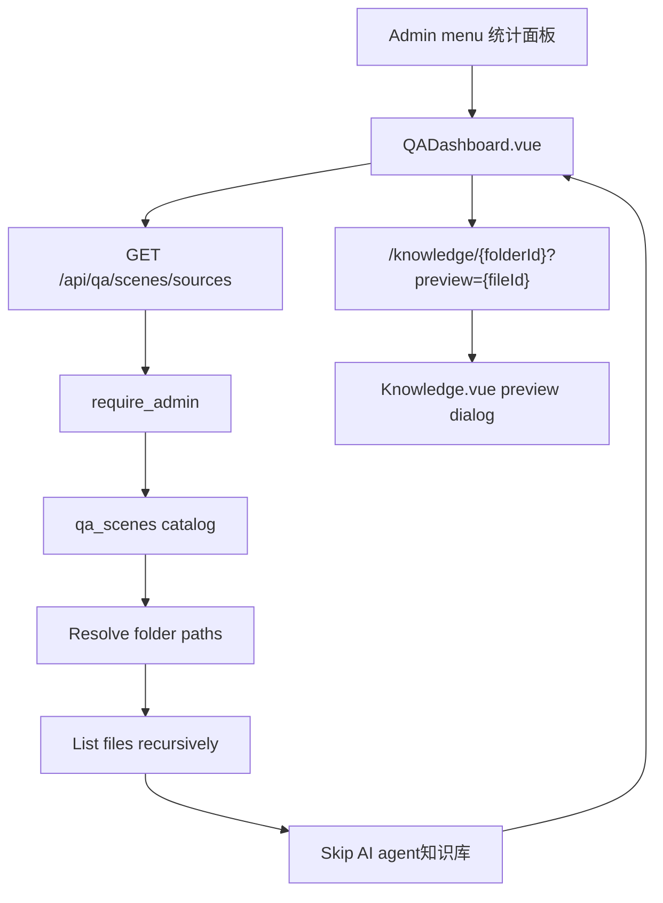

# QA Scene Source List

Feature Name: qa-scene-source-list
Updated: 2026-11-23

## Description

将知识库问答资料清单放进智能问答「统计面板」（`/qa/dashboard`，菜单原名「问答看板」）。管理员打开该页即可一次看到全部板块及其检索范围内的知识库文件。清单字段为文件名、所属目录路径、文件类型、更新时间。点击文件跳转到知识库对应目录并打开预览。

普通用户仍可打开统计面板查看用量概览，但看不到资料清单区块，也无法调用清单接口。清单范围与 `QA.vue` 场景卡片的目录路径映射、以及 `qa.py` 的递归收集规则保持一致，并跳过「AI agent知识库」。

## Architecture



后端持有板块到知识目录路径的权威映射。清单接口只返回元数据，不读取文件正文。统计面板中的资料清单区块消费该接口；知识库问答首页的场景卡片继续使用现有 `SCENE_CARDS`，由测试约束两边路径一致。

## Components and Interfaces

### Scene catalog

新增 `backend/app/utils/qa_scenes.py`。

每个板块包含 `key`、`kicker`、`title`、`paths`。`paths` 与 `frontend/src/views/QA.vue` 中 `SCENE_CARDS` 当前定义对齐：

- `style`: `写作规范/写作风格指南`
- `sentence`: `写作规范/句式清单`
- `review`: `写作规范/常见错误清单`、`写作规范/技术文档审核规则库`、`写作规范/说明书自检checklist`、`写作规范/审核依据汇总`
- `term`: `资源库/术语库`
- `tm`: `资源库/记忆库`
- `files`: `资源库/文件资料`

提供 `resolve_scene_folders(db, scene)` 与 `list_scene_files(db, scene)`。收集逻辑复用 `folder_path_names`、`is_agent_kb_folder`，按子孙目录递归列文件，同一文件 id 只出现一次。

### Inventory API

在 `backend/app/api/qa.py` 新增：

`GET /api/qa/scenes/sources`

依赖 `require_admin`。响应：

```json
{
  "scenes": [
    {
      "key": "style",
      "kicker": "写作规范",
      "title": "查写作规范与风格",
      "file_count": 2,
      "missing_paths": [],
      "files": [
        {
          "id": 12,
          "name": "中文技术文档写作风格指南.md",
          "folder_id": 4,
          "folder_path": "写作规范/写作风格指南",
          "file_type": "md",
          "updated_at": "2026-11-20T10:00:00"
        }
      ]
    }
  ]
 }
```

`missing_paths` 记录知识树中找不到的映射路径，供空态文案使用。

普通用户调用返回 HTTP 403，详情为「仅管理员可操作」。

### Stats panel

复用 `frontend/src/views/QADashboard.vue`。

- 菜单文案由「问答看板」改为「统计面板」，页面标题同步改为「统计面板」
- 路由保持 `/qa/dashboard`
- 管理员在图表下方、对话明细上方看到「知识库问答资料清单」
- 按板块分段，每段标题旁显示资料份数；表格列为文件名、所属目录、类型、更新时间
- 空态：板块无文件时显示「该板块暂无资料」；若有 `missing_paths` 附加「目录待同步」
- 点击行：`router.push({ path: '/knowledge/' + folder_id, query: { preview: file_id } })`

`frontend/src/api/index.js` 增加 `qaAPI.getSceneSources()`。

普通用户打开统计面板时隐藏资料清单区块。

### Knowledge preview handoff

`Knowledge.vue` 在进入 `/knowledge/:id` 后读取 `preview` 查询参数。若对应文件属于当前目录，则调用现有 `handlePreviewFile` 打开预览对话框，随后从 URL 去掉该查询参数，避免刷新重复打开。

## Data Models

不新增数据库表。清单数据来自现有 `Folder` 与 `KnowledgeFile`。

内存结构：

- `QaScene`: `key`, `kicker`, `title`, `paths: list[list[str]]`
- `QaSceneFile`: `id`, `name`, `folder_id`, `folder_path`, `file_type`, `updated_at`
- `QaSceneInventory`: `key`, `kicker`, `title`, `file_count`, `missing_paths`, `files`

`updated_at` 使用知识库文件已有时间戳，ISO 8601 字符串输出。

## Correctness Properties

- 清单中的文件集合等于该板块 `knowledge_ids` 交给 `_load_qa_documents` 时会纳入的文件集合（按文件 id），清单侧不要求文件正文可解析。
- 「AI agent知识库」及其子孙目录中的文件不出现在任何板块清单中。
- 同一文件 id 在同一板块清单中只出现一次。
- `QA.vue` 的 `SCENE_CARDS.paths` 与后端 `qa_scenes` 的 `paths` 按 `key` 完全一致。
- 非管理员无法看到资料清单区块，也无法从接口读取清单。

## Error Handling

- 知识树加载失败：资料清单区块提示「知识库目录加载失败」，保留已渲染的板块空壳。
- 映射路径在知识树中不存在：该板块 `file_count` 为 0，展示「该板块暂无资料 / 目录待同步」。
- 预览接口失败：知识库页沿用现有「预览失败」提示。
- 未登录访问接口：沿用现有 OAuth2 鉴权，返回 401。
- 普通用户访问接口：返回 403。

## Test Strategy

- 后端单测 `test_qa_scenes.py`：路径解析、递归含子目录、跳过 agent 知识库、文件去重、缺失路径进入 `missing_paths`。
- 后端 API 测：管理员 200 且字段完整；普通用户 403。
- 对照测：`SCENE_CARDS` 路径与后端 catalog 一致。可将前端路径抽成常量或在测试中固化一份期望映射。
- 前端：管理员在统计面板看到资料清单；普通用户打开同一页时该区块隐藏。
- 手工验收：`admin` / `admin123` 打开 `/qa/dashboard` 查看六块清单；点击文件进入知识库预览；`rolecheck_user` / `user12345` 看不到资料清单。

## References

[^1]: (Filename) - 知识库问答场景卡片 `frontend/src/views/QA.vue`
[^2]: (Filename) - 问答文档收集 `backend/app/api/qa.py`
[^3]: (Filename) - 范围辅助 `backend/app/utils/qa_knowledge_scope.py`
[^4]: (Filename) - 知识库预览 `frontend/src/views/Knowledge.vue`
